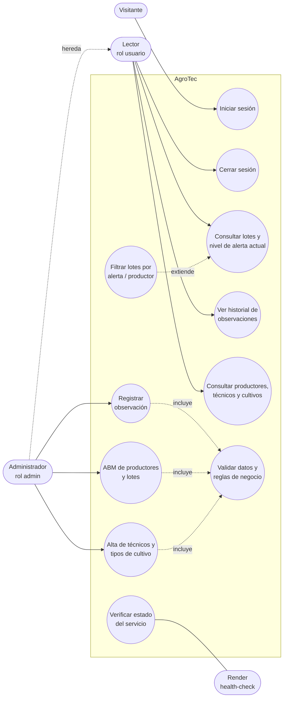
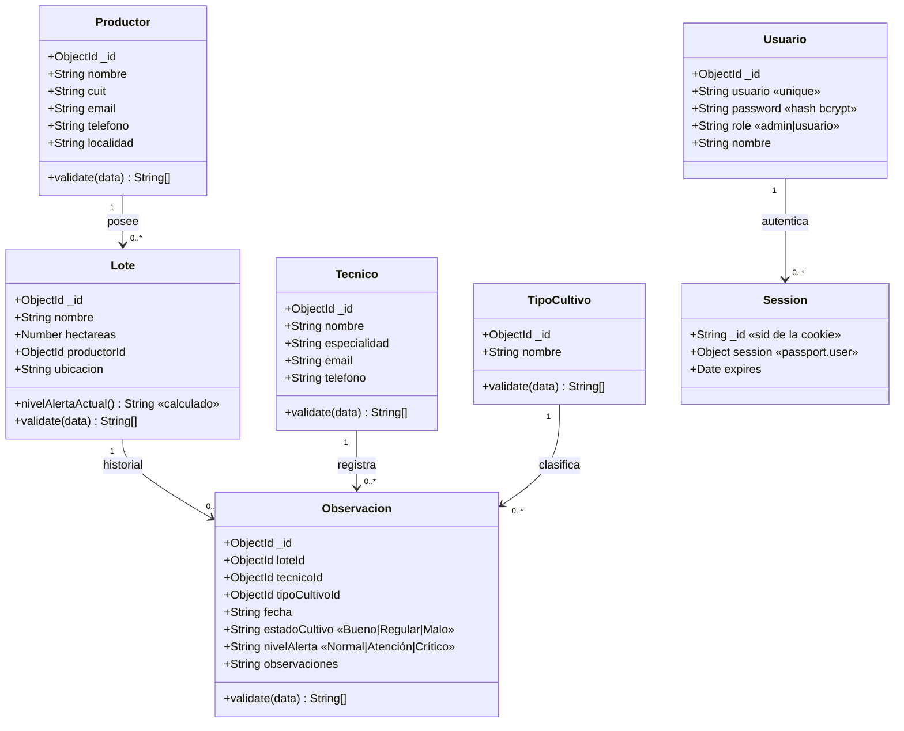
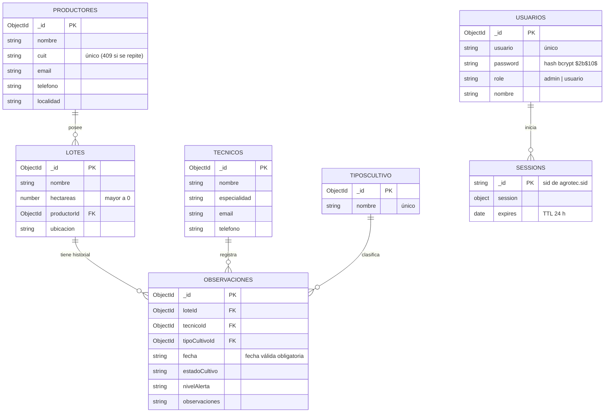
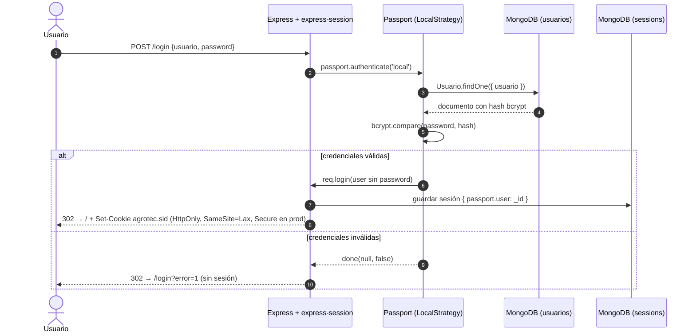
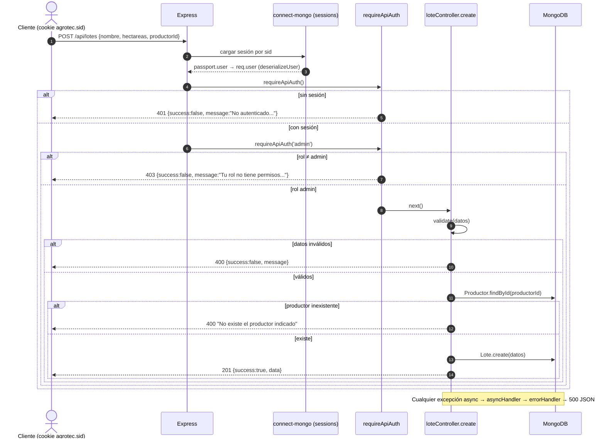
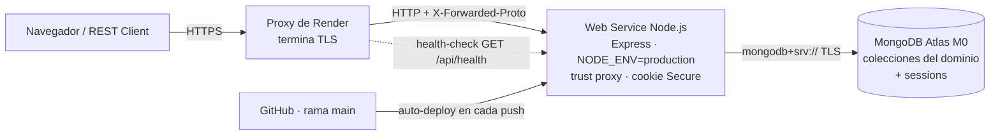
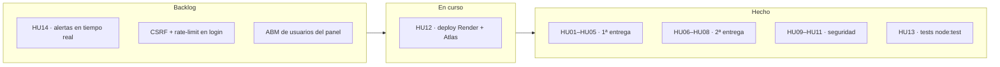
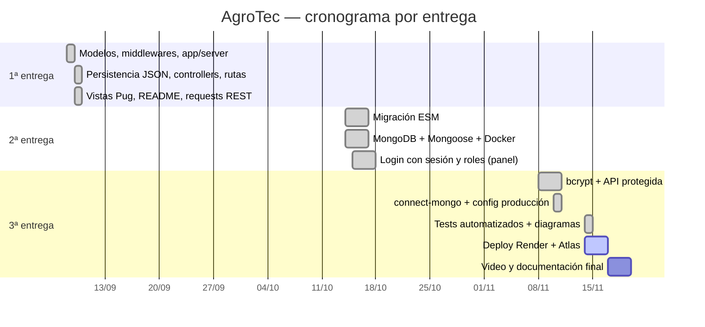

# Diagramas del sistema — AgroTec (3ª entrega)

Diagramas en [Mermaid](https://mermaid.js.org/): GitHub los renderiza directamente al abrir este archivo.
Para insertarlos en el PDF, abrir `docs/diagramas.html` en el navegador (o pegar cada bloque en <https://mermaid.live>) y exportar como imagen.

---

## 1. Diagrama de casos de uso

Actores: **Visitante** (sin sesión), **Lector** (rol `usuario`), **Administrador** (rol `admin`) y **Render** (sistema externo que hace el health-check). El administrador hereda todo lo que puede hacer el lector.

## 2. Diagrama de clases

Modelos Mongoose (`src/models/`) y sus relaciones por referencia (`ObjectId`). `nivelAlertaActual` no se guarda: se calcula a partir de la observación más reciente del lote.

## 3. Modelo de datos (ER)

Reglas de integridad que la aplicación hace cumplir (MongoDB no tiene FK): no se puede borrar un productor con lotes (409), ni un lote con observaciones (409); las observaciones no se borran nunca (403, RF09).

## 4. Diagrama de secuencia — inicio de sesión

## 5. Diagrama de secuencia — escritura protegida en la API

## 6. Arquitectura de despliegue

## 7. Planificación del equipo

### 7.1 Backlog de historias de usuario (priorizado)

Prioridad MoSCoW (Must / Should / Could). Estimación en puntos de historia (1 = muy simple, 8 = compleja). Backlog reconstruido a partir del historial de commits y PRs del repositorio.

| ID | Historia de usuario | Prioridad | Est. | Entrega | Responsable |
|---|---|---|---|---|---|
| HU01 | Como coordinador quiero gestionar productores para saber a quién pertenece cada lote | Must | 3 | 1ª | Ortiz |
| HU02 | Como coordinador quiero gestionar lotes asociados a un productor | Must | 3 | 1ª | Ortiz |
| HU03 | Como técnico quiero registrar observaciones con fecha, estado y nivel de alerta | Must | 5 | 1ª | Ortiz / Bargaz |
| HU04 | Como coordinador quiero ver el nivel de alerta actual de cada lote | Must | 3 | 1ª–2ª | Ortiz |
| HU05 | Como usuario quiero un panel web para consultar lotes y observaciones | Should | 5 | 1ª | Grigolatto |
| HU06 | Como equipo queremos persistir los datos en MongoDB en lugar de archivos JSON | Must | 8 | 2ª | Bargaz |
| HU07 | Como equipo queremos migrar el código a módulos ESM | Should | 3 | 2ª | Ortiz |
| HU08 | Como admin quiero iniciar sesión y que solo yo pueda cargar observaciones | Must | 5 | 2ª | Grigolatto |
| HU09 | Como responsable de seguridad quiero contraseñas hasheadas con bcrypt | Must | 2 | 3ª | Grigolatto |
| HU10 | Como responsable de seguridad quiero que la API exija sesión y rol | Must | 5 | 3ª | Grigolatto |
| HU11 | Como usuario quiero que mi sesión no se pierda cuando el servidor se reinicia | Should | 3 | 3ª | Grigolatto |
| HU12 | Como cliente quiero acceder al sistema desde internet (Render + Atlas) | Must | 5 | 3ª | Equipo |
| HU13 | Como equipo queremos pruebas automatizadas de las reglas críticas | Could | 2 | 3ª | Equipo |
| HU14 | Como coordinador quiero alertas en tiempo real (Socket.IO) | Could | 8 | futura | — |

### 7.2 Tablero (estado al cierre de la 3ª entrega)

### 7.3 Cronograma de las tres entregas

